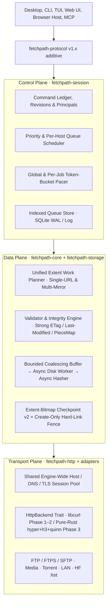

# Engine 2.0 redesign: SOTA download data plane, control plane and transport

Date: 26 November 2026 · Milestone: **M20** (`FP-145`–`FP-156`) · Supersedes the prefix-only HTTP scheduler limits in [the FP-083 spec](2026-09-29-stream-first-http-scheduler-design.md) while preserving every correctness, security, and platform invariant from [the engine platform design](2026-09-24-engine-platform-design.md) and [the job contract](../JOB-CONTRACT.md).

## 1. Diagnosis of the 0.4.1 engine

The 0.4.1 engine's macro-architecture (single headless per-user owner, thin clients over an authenticated named pipe, idempotent command ledger, optimistic revisions, principal isolation, and create-only publication) is sound and stays intact. The gaps holding Fetchpath back from SOTA download-manager performance and capability are concentrated in the data plane, scheduler, and transport boundary:

| # | Bottleneck / gap in 0.4.1 | Where | Measured / operational impact |
| --- | --- | --- | --- |
| 1 | **Prefix-starvation thrashing loop** | `crates/fetchpath-http/src/scheduler.rs` (`slower_than_median`, `fill_one`, `write_clipped`) | 3 s `max_ahead` + 1 s `BLOCK_GRACE` + zero-margin `mine < max(median, learned_rate)` kills healthy prefix lanes and clips non-prefix lanes. Produced 78–164 replacements and **192.7 s vs curl 37.8 s** (5.1× slower) on Hugging Face ([evidence](../../development/evidence/http-adaptive/fp086-internet.json)). |
| 2 | **HTTP/2 width-vs-socket ordering trap** | `crates/fetchpath-http/src/scheduler.rs` (`window_step`, `pool_step`) & `controller.rs` | Width probe doubles streams on 1 multiplexed TCP socket, sees no gain on per-socket-limited origins, permanently locks `Controller` to `Stage::Settled(2)`, and only *then* runs `PoolPolicy::Trial` without unlocking width growth. |
| 3 | **3× full-file SHA-256 + callback-thread disk read-back** | `crates/fetchpath-core/src/checkpoint.rs`, `transfer.rs`, `crates/fetchpath-storage/src/lib.rs` | Every download hashes 100% of bytes during transfer (synchronously reading back out-of-order bytes inside libcurl's write callback, tripping backpressure), re-hashes the whole staging file after `sync_payload`, and re-hashes it a third time in `store.publish() -> validate_staging()`. |
| 4 | **Unbuffered 16 KiB positional syscalls, NTFS VDL zero-fill, prefix-only checkpoints** | `crates/fetchpath-core/src/transfer.rs`, `crates/fetchpath-storage/src/lib.rs` | ~65,536 `seek_write` syscalls/GiB on the socket thread; 25–40% NTFS VDL overhead on out-of-order writes ([evidence](../../development/evidence/http-adaptive/fp084-ntfs-write.json)); scalar `committed_len` discards all out-of-order bytes on pause/crash. |
| 5 | **Irreversible controller lock-in & 4-lane cap** | `crates/fetchpath-http/src/controller.rs`, `lib.rs` | One noisy probe window or transient dip permanently disables scaling; default cap of 4 lanes trails `aria2 -x16` on per-connection-limited and high-latency paths ([comparison](../../development/evidence/http-adaptive/fp087-comparison.json)). |
| 6 | **Disconnected pipelines & missing controls** | `crates/fetchpath-core/src/verified.rs`, `fetchpath-http/src/compatibility.rs`, `fetchpath-session/src/lib.rs` | Multi-source/Metalink is sequential (`MAX_CONCURRENT_MIRROR_ATTEMPTS = 1`) and unwired; FTP/SFTP stops at `fetchpath-http`; no bandwidth limiting, job priorities, strong `Last-Modified` resume, cross-job connection pooling, HTTP/3, or scalable queue persistence. |

## 2. Target architecture

Engine 2.0 keeps the existing crate boundaries lean (no crate explosion; new components enter [REPOSITORY.md](../REPOSITORY.md) only when implemented) and separates the engine into three explicit planes:

### Plane ownership and invariants that never move

1. **Control Plane (`fetchpath-session` + `apps/cli/src/engine`):** Sole owner of queue state, command idempotency ledger, optimistic revisions, principals/approvals (D1/D6/D7), credentialed provenance (D8), share tickets (D9), smart rules, priorities, bandwidth budgets, and disk reserve. Blocking disk/hash work never runs while holding the queue state mutex.
2. **Data Plane (`fetchpath-core` + `fetchpath-storage`):** Protocol-agnostic transfer orchestration, unified extent planning across single-URL and multi-mirror jobs, RFC 9110 representation validation, coalesced async disk I/O, single-pass hashing, extent-bitmap checkpoints, and create-only no-overwrite publication.
3. **Transport Plane (`fetchpath-http` + `adapters/*`):** Shared engine-wide connection/DNS/TLS pooling (strictly isolated by principal and credential scope), pluggable HTTP backend (`HttpBackend` trait), compatibility transports (FTP/FTPS/SFTP), and specialized adapters (Media, Torrent, LAN, HF Xet).
4. **Unchanged invariants:** Never mix representations without trusted digests; never treat locally computed hashes as publisher authenticity; never silently overwrite an existing destination; never leak cookies, tokens, or signed query strings into telemetry, cache provenance, or cross-origin redirects; never enable sharing or peer upload implicitly.

## 3. Core technical designs

### 3.1 Scheduler & concurrency controller v2 (FP-145)

- **Eliminate prefix-starvation thrashing:**
  - Replace the zero-margin `mine < median` check with a real hysteresis threshold (`mine < 0.35 * reference`, where `reference` uses a decaying EWMA of active lanes, never an unbounded historical peak).
  - Never clip or abort healthy non-prefix lanes when `max_ahead` temporarily shrinks; only gate *new* claims past the budget.
  - Raise the `BLOCK_GRACE` and couple run-ahead freedom to extent checkpoints (once FP-147 lands, `max_ahead` is no longer tied to 3 s of discardable prefix lag).
- **Fix HTTP/2 socket-vs-stream ordering:**
  - Probe independent sockets *before* concluding a width ceiling on HTTP/2: when an H2 width probe fails to gain on a shared socket, run the bounded independent-connection trial; if independent connections win by ≥15% across two valid windows, **unlock `Controller`** so it can scale up to the configured cap across independent sockets.
- **Recoverable concurrency controller:**
  - Replace permanent `Stage::Settled` lock-in with a bounded cooldown (e.g., 20–30 s exponential backoff) so a transient WAN dip or single noisy window does not pin a multi-GiB download to 1–2 lanes forever.
  - Raise the default `max_concurrency` ceiling from 4 to **8** (rule/user-configurable up to **16**, bounded by `GlobalBudget`), while keeping starting width conservative (2 lanes) so unthrottled or per-client-limited origins do not waste connections.

### 3.2 Single-pass hashing & decoupled async I/O pipeline (FP-146, FP-148)

- **End 3× SHA-256 redundancy (FP-146):**
  - Move out-of-order prefix hashing completely off the libcurl write callback thread.
  - Eliminate the redundant post-`sync_payload` full-file re-read when the streaming/extent digest already covers `[0, total)` without gaps.
  - Eliminate the duplicate `validate_staging()` re-hash inside `store.publish()` on fresh in-process publication (`publish_verified()` takes the in-process verified intent after `sync_payload`, while crash-recovery `reconcile_publication()` retains full disk re-verification!).
- **Coalesced async disk I/O & NTFS VDL handling (FP-148):**
  - Replace per-16-KiB `seek_write` syscalls on the network thread with a bounded per-lane coalescing buffer (256 KiB–1 MiB) feeding a dedicated async disk writer thread via a bounded channel (propagating backpressure via libcurl `CURL_WRITEFUNC_PAUSE` or async read suspension).
  - On Windows NTFS, evaluate and apply `FSCTL_SET_SPARSE` on segmented staging files (with `ntfs-write.mjs` benchmark proof) to eliminate synchronous Valid Data Length zero-fill double writes, clearing/compacting or avoiding sparse allocation on sequential single-lane downloads.

### 3.3 Extent-bitmap checkpoints v2 (FP-147)

- Upgrade `fetchpath-storage` checkpoints from scalar `[0, committed_len)` to **Format v2**: an ordered list of completed extents `[(start, end, blake3_or_sha256_block_digest), ...]` plus `total_bytes`, `validator` (strong ETag or RFC 9110 strong Last-Modified), and `phase` (`Downloading` | `PublicationIntent`).
- Backward compatibility: v1 checkpoints remain readable on startup and upgrade cleanly on commit.
- Crash & pause impact: pausing or killing the engine preserves **every completed segment across all lanes** (loss drops from ~4 s of aggregate goodput + all out-of-order lanes to only the unflushed in-memory write buffer, bounded to a few MiB).
- Enables unified single-URL + multi-mirror extent planning and removes the prefix-choke bottleneck permanently.

### 3.4 Real-world compatibility, pacing, priorities & shared pooling (FP-149, FP-150, FP-151)

- **Validators & HTTP compatibility (FP-149):**
  - Implement RFC 9110 §13.1.5 strong `Last-Modified` validation (`Date - Last-Modified >= 1s` when no strong ETag is present) so mirrors and CDNs without strong ETags support safe resume and segmentation.
  - Allow transparent `Accept-Encoding: gzip, br, zstd` on non-ranged sequential transfers (and `identity` whenever byte-range segmentation is active).
  - Extend `RequestContext` cleanly for scoped `User-Agent`, custom headers, and proxy settings (strictly respecting cross-origin stripping and redaction).
- **Bandwidth pacing & queue priorities (FP-150):**
  - Add a shared hierarchical token-bucket pacer (engine-wide ceiling, optional background/interactive mode, and per-job limit) applied directly to receive/read scheduling.
  - Add job priority (`high`, `normal`, `low`) and per-host concurrency fairness to `fetchpath-session`, exposed additively via `PolicyPatch` (`UpdatePolicy`) and `EngineSettings` in `fetchpath-protocol`.
- **Shared host connection/DNS/TLS pool (FP-151):**
  - Share DNS, TCP, and TLS session caches across concurrent jobs targeting the same origin within the same `(principal, credential_scope)` partition — eliminating repeated TLS handshakes across batches and Hugging Face repository downloads while preserving strict principal/cookie isolation.

### 3.5 Pluggable transport seam, pure-Rust HTTP/3, multi-source & scalable store (FP-152–FP-156)

- **`HttpBackend` seam + pure-Rust HTTP/1.1 / HTTP/2 / HTTP/3 (QUIC) evaluation & rollout (FP-152):**
  - Isolate `fetchpath-http`'s transport operations behind an internal `HttpBackend` trait so the scheduler, validator, redirect pinner, and tests are backend-agnostic.
  - Build a pure-Rust Tokio backend (`hyper` + `h2` + `quinn`/`h3` + `rustls` with Windows platform verifier) with opportunistic HTTP/3, Happy Eyeballs v2 fallback, and blocked-UDP detection.
  - Promote to default only after passing the A06/A09 controlled H1/H2/H3 + blocked-UDP + Internet comparative gate against `libcurl`, `curl`, and `aria2`. Unifies the async runtime across HTTP, SFTP, Torrent, and Relay.
- **Unified multi-source / Metalink concurrent striping (FP-153):**
  - Retire the sequential single-connection path in `verified.rs` (`MAX_CONCURRENT_MIRROR_ATTEMPTS = 1`) in favor of the unified extent planner striping across healthy mirrors concurrently, with per-piece trusted verification and selective repair, wired into `fetchpath-session` and `fetchpath-protocol`.
- **Compatibility transport & Xet wiring (FP-154, FP-155):**
  - Wire FTP/FTPS/SFTP (`compatibility.rs`) into `fetchpath-core` and `fetchpath-session` with explicit credential references and host-key/CA handling.
  - Evaluate and add Hugging Face Xet chunk reconstruction in `adapters/providers` reusing `fetchpath-cache` chunks across model versions.
- **Scalable queue persistence & lock-free reconcile I/O (FP-156):**
  - Replace O(N) full-file `queue.json` pretty-print rewrites with SQLite WAL (or an indexed append-log) with automatic one-way migration from JSON v1/v2 queues and move blocking provenance/directory I/O off the main `Session` mutex.

## 4. Phased delivery & promotion gates (Milestone M20)

Every performance phase must pass the paired benchmark gate in [PLAN.md §9](../PLAN.md#9-benchmark-plan-earn-the-speed-claim) and record raw paired runs in [docs/development/ENGINE-REDESIGN.md](../../development/ENGINE-REDESIGN.md):

| Phase | Tasks | Target gate |
| --- | --- | --- |
| **Phase 1 — Immediate Wins (P0)** | `FP-145`, `FP-146` | Hugging Face 440 MB: eliminate `prefixStarvation` churn (≤2 replacements) and reach ≤1.15× `curl` median (down from 5.1×). Unshaped / no-ETag 64 MiB loopback: eliminate post-100% double re-hash and reach parity with `curl` core transfer time. All existing recovery/fault/identity tests pass unchanged. |
| **Phase 2 — SOTA Data Plane & Controls (P1)** | `FP-147`, `FP-148`, `FP-149`, `FP-150`, `FP-151` | Pause/crash retains all completed out-of-order extents; NTFS out-of-order write overhead ≤10% over sequential; `per-connection-limit` matches `aria2 -x8`–`x16` within budget; bandwidth limit holds within ±5% over 5 s windows; batch of 50 same-host files reuses TLS connections; `Last-Modified`-only mirrors resume & segment safely. |
| **Phase 3 — SOTA Transport & Scale (P2)** | `FP-152`, `FP-153`, `FP-154`, `FP-155`, `FP-156` | Controlled H1/H2/H3 + blocked-UDP fallback passes A06; multi-mirror striping beats single-mirror on shaped mirrors with corrupt-piece selective repair; FTP/SFTP & Xet pass compatibility/reuse gates; 5,000-job queue commit stays <5 ms p95 without stalling active transfers. |

## 5. Task map

Authoritative status lives in [docs/tasks/backlog.json](../../tasks/backlog.json):

- `FP-145` (P0, strong): Fix prefix-starvation thrashing, H2 socket-vs-stream ordering, controller cooldown recovery, and lane cap.
- `FP-146` (P0, strong): Eliminate 3× SHA-256 hashing and move hashing/read-back off the socket callback thread.
- `FP-147` (P1, strong): Extent-bitmap checkpoint format v2 in `fetchpath-storage` and `fetchpath-core`.
- `FP-148` (P1, strong): Coalesced write buffers, dedicated async disk writer, and Windows NTFS sparse/VDL-aware staging.
- `FP-149` (P1, standard): RFC 9110 strong `Last-Modified` resume/segmentation and flexible `RequestContext` (UA, headers, proxy, sequential compression).
- `FP-150` (P1, strong): Global and per-job bandwidth limiting, job priorities, and per-host fairness in `fetchpath-session`.
- `FP-151` (P1, strong): Shared engine-wide HTTP connection, DNS, and TLS session pool across concurrent jobs.
- `FP-152` (P2, strong): `HttpBackend` transport seam and pure-Rust async HTTP/1.1 + HTTP/2 + HTTP/3 (QUIC) backend.
- `FP-153` (P2, strong): Unified concurrent multi-source / Metalink striping on the extent planner, wired into `fetchpath-session`.
- `FP-154` (P2, strong): Wire FTP, FTPS, and SFTP compatibility transports into `fetchpath-core` and `fetchpath-session`.
- `FP-155` (P2, standard): Hugging Face Xet chunk-deduplication provider adapter.
- `FP-156` (P2, strong): Scalable queue persistence (SQLite WAL / indexed log) and off-mutex reconcile I/O.
